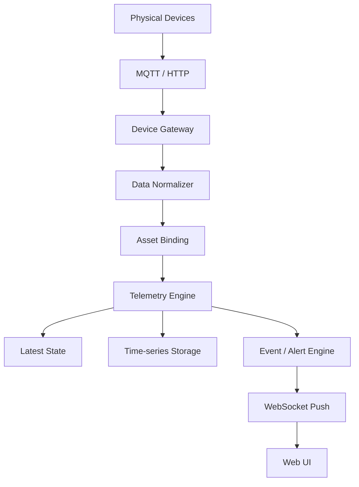

<div align="center">

# AssetStudio

**Industrial Asset Visualization Platform · 工业资产可视化平台**

by WUXU · 物序

让每一个物理资产都拥有数字身份，让复杂的设备系统变得可见、可管理、可理解。

[项目简介](#项目简介) · [核心能力](#核心能力) · [设计理念](#设计理念) · [技术架构](#技术架构) · [路线图](#路线图) · [产品文档](docs/prd.md)

</div>

---

## 项目简介

AssetStudio 是一款面向**工业物联网与专业设备场景**的开源可视化资产管理与监控平台。

它不是传统的 ERP 资产台账，也不是一个简单的 IoT Dashboard，而是以「物理资产数字化」为核心，将**设备、传感器、空间、数据、关系和运行状态**组织在一个统一的数字化环境中。

它不取代已有的工业控制系统、SCADA 或 MES，而是作为这些系统之上的一个**轻量级数字化资产管理与可视化层**。

### 它解决什么问题

| 现有问题 | AssetStudio 的解决方向 |
| --- | --- |
| 设备信息分散在不同系统 | 统一设备与资产模型 |
| 设备之间的关系不直观 | 可视化拓扑与层级关系 |
| 设备数据缺少业务上下文 | 设备与实时数据关联 |
| 监控页面需要大量人工配置 | 可视化 Dashboard 编辑器 |
| 设备状态难以整体感知 | 实时状态与事件可视化 |
| 系统之间缺少统一数据接口 | 标准化 API 与数据接入机制 |
| 传统系统部署复杂 | Docker 自主部署 |

### 面向谁

工业物联网开发者、自动化工程师、设备管理与运维人员、工业系统集成商，以及有设备数据可视化需求的中小型制造企业技术团队。

---

## 核心能力

AssetStudio 由六个核心模块组成，但它们并非彼此独立的六个功能块，而是围绕同一个 Asset 领域模型展开。

| 模块 | 说明 | 关键能力 |
| --- | --- | --- |
| **01 · Asset Management** 资产管理 | 管理物理设备及其数字身份 | 设备注册与编辑、分类标签、型号模板、属性元数据、生命周期状态、附件文档 |
| **02 · Asset Topology** 资产拓扑 | 以可视化方式管理设备之间的关系 | 层级结构、父子与连接关系、拓扑画布编辑、设备状态映射 |
| **03 · Device Connectivity** 设备接入 | 连接真实设备与外部数据源 | MQTT、HTTP API、设备身份认证、数据点映射、数据模拟器 |
| **04 · Telemetry** 数据监控 | 将实时数据与设备模型关联 | 实时采集、时序存储、历史查询、数据曲线、运行状态、阈值告警 |
| **05 · Dashboard Studio** 可视化工作台 | 用户自主设计设备监控页面 | 拖拽布局、图表组件、状态卡片、数据绑定、页面保存与分享 |
| **06 · Events & Alerts** 事件与告警 | 管理设备运行过程中的异常 | 阈值规则、状态变化事件、告警记录与确认、通知接口、事件历史 |

---

## 设计理念

> 资产是核心对象，数据是资产的动态表现，拓扑是资产之间的关系，可视化是用户理解整个系统的主要方式。

这四者从数据模型层面就建立关联，而不是分别开发六个互不相干的功能模块。

### 以 Asset 为中心

| 对象 | 说明 | 示例 |
| --- | --- | --- |
| Asset | 物理资产的数字身份 | 一台空压机 |
| AssetType | 资产类型 | 空压机、泵、电机 |
| AssetTemplate | 资产模板 | 某型号空压机模板 |
| Attribute | 静态属性 | 型号、厂商、序列号 |
| Telemetry | 动态数据 | 温度、压力、转速 |
| Relationship | 资产关系 | 从属、连接、安装 |
| Location | 物理位置 | 厂区、车间、生产线 |
| Event | 运行事件 | 启动、停止、异常 |
| Alarm | 告警记录 | 温度超过阈值 |
| Dashboard | 可视化视图 | 设备运行监控面板 |

需要严格区分三个概念：

- **Attribute**：设备相对稳定的属性。
- **Telemetry**：随时间变化的测量数据。
- **State**：系统根据设备数据和业务规则计算出的当前状态。

```json
{
  "id": "asset-001",
  "name": "Compressor A",
  "code": "COMP-A-001",
  "type": "compressor",
  "status": "running",
  "location_id": "location-001",
  "attributes": {
    "manufacturer": "Example",
    "model": "AC-200"
  },
  "tags": ["workshop-a", "production"],
  "metadata": {}
}
```

### 业务资产与接入设备分离

一台空压机可能由工业网关连接多个传感器，因此对应关系并非强制一对一：

- `parent_id`：层级归属
- `relationships`：任意实体关系
- `location_id`：空间位置
- `asset_type_id`：类型归类

**不要把所有关系都塞进一棵设备树中**——树形结构无法完整表达工业设备之间的供能、连接、控制等关系。

---

## 产品界面

AssetStudio 的核心竞争力体现在 UI/UX 上。整体采用「左侧主导航 + 顶部项目栏 + 中央工作区」的现代工程软件工作台结构。

第一版优先打磨三个界面：

### Asset Explorer · 资产资源管理器

左侧资产树、中间资产列表或卡片、右侧资产详情，支持快速搜索、筛选、标签与关系查看。

### Topology Studio · 拓扑工作台

拖拽设备到画布、连接设备与传感器、自动布局、状态实时映射、点击节点查看详情，并支持保存多个拓扑视图。它不是普通的流程图编辑器，而是一个 **Asset-aware Canvas**——画布中的节点直接绑定真实资产，连线对应真实关系。

### Dashboard Studio · Dashboard 工作台

拖拽组件、配置数据源、绑定资产与数据点、实时预览、保存与发布。第一版计划支持数值卡片、折线图、仪表盘、状态指示器、设备卡片、告警列表、设备表格、柱状图、设备拓扑与文本组件。

---

## 技术架构

AssetStudio 从第一天就采用模块化、可扩展的架构，但第一版**不过度微服务化**。

```
┌─────────────────────────────────────────────────────────┐
│                    AssetStudio Web                       │
│         React · TypeScript · Visual Editors              │
├─────────────────────────────────────────────────────────┤
│                   Go Application Core                    │
│        REST API · WebSocket · Authentication · RBAC      │
├──────────────┬──────────────┬──────────────┬────────────┤
│ Asset Domain │Device Gateway│Telemetry     │Visualization│
│              │MQTT / HTTP   │Engine        │Engine      │
├──────────────┴──────────────┴──────────────┴────────────┤
│        Event Engine · Extension System                   │
├─────────────────────────────────────────────────────────┤
│ PostgreSQL · Time-series Storage · MQTT Broker · Storage │
└─────────────────────────────────────────────────────────┘
```

### 技术栈

| 模块 | 技术 | 选择原因 |
| --- | --- | --- |
| Web | React + TypeScript | 工程生态成熟 |
| UI | Tailwind CSS + shadcn/ui | 组件开发效率 |
| 拓扑 | React Flow | 设备关系与画布 |
| 图表 | ECharts | 时序与数据展示 |
| 3D | Three.js | 后续数字孪生 |
| Backend | Go | 性能、部署、工程化 |
| API | REST + WebSocket | 简单、通用 |
| ORM | GORM 或 sqlc | 结合复杂查询需求选择 |
| Database | PostgreSQL | 核心业务数据 |
| Time-series | TimescaleDB（可选） | 时序数据 |
| MQTT | Mosquitto | 消息接入 |
| Cache | Redis（按需） | 缓存及短期状态 |
| Deployment | Docker Compose | 快速部署 |

### 数据接入流程



核心是 **Data Normalizer**：无论数据来自 MQTT、HTTP，还是未来的 Modbus、OPC UA，都统一成内部 Telemetry 格式。这样增加协议时，无需修改上层的资产管理、数据监控和 Dashboard。

```json
{
  "device_id": "device-001",
  "asset_id": "asset-001",
  "timestamp": 1793520000000,
  "values": {
    "temperature": 68.5,
    "pressure": 0.82,
    "speed": 2850
  }
}
```

### 关键工程决策

1. **设备接入与业务 API 分离**：持续高频的数据流不与普通 CRUD API 混在同一处理链路。
2. **Telemetry 与 Asset 分离存储**：静态属性用 PostgreSQL，时序数据先用原生表，增长后引入 TimescaleDB 或独立时序存储。
3. **在线状态不只看最后一条数据**：综合心跳、连接状态、超时时间和上报规则计算。
4. **所有数据都有明确时间语义**：区分设备产生时间、服务端接收时间与入库时间。
5. **第一版只支持 MQTT 与 HTTP**：其他工业协议通过独立 Gateway 或协议适配器接入。

### 设备模拟器

设备模拟器纳入 V0.1，无需真实工业硬件即可完整演示：

- 模拟不同类型设备，按配置产生温度、压力、转速等数据
- 模拟上下线、正常与异常状态、数据波动和故障事件
- 支持 MQTT 与 HTTP 两种输出

---

## 路线图

第一版以一个完整场景作为验收标准：**创建工厂项目 → 注册设备 → 接入模拟数据 → 拓扑与 Dashboard 查看状态 → 触发并收到异常告警。**

| 阶段 | 核心任务 | 验收标准 |
| --- | --- | --- |
| P1 | 工程初始化、基础 UI、项目管理 | 可以创建项目 |
| P2 | Asset Domain、设备管理 | 可以完成资产 CRUD |
| P3 | MQTT / HTTP、模拟器 | 数据正常接入 |
| P4 | Telemetry Engine | 实时数据与历史数据可查询 |
| P5 | Asset Topology | 画布节点绑定真实资产 |
| P6 | Dashboard Studio | 可以编辑、保存、发布监控面板 |
| P7 | Event / Alert | 异常检测与告警确认 |
| P8 | 部署、文档、开源发布 | Docker 一键运行 |

### 版本能力规划

| 功能 | V0.1 | V0.2 | V1.0 |
| --- | --- | --- | --- |
| 项目管理 / 资产 CRUD / 类型模板 / 层级 | ✓ | | |
| 资产关系 | 基础 | 增强 | |
| MQTT / HTTP 接入 | ✓ | | |
| 设备模拟器 | ✓ | 增强 | |
| 实时数据 / 历史曲线 | ✓ | 增强 | |
| 拓扑画布 | ✓ | 增强 | |
| Dashboard 编辑器 | 基础 | 增强 | |
| 阈值告警 | ✓ | | |
| Modbus / OPC UA | | ✓ | |
| 多用户权限 | 基础 | | 增强 |
| 3D 数字孪生 / 插件市场 / 高可用部署 | | | ✓ |

> 当前项目处于 **V0.1 设计与工程初始化阶段**，代码与可运行版本尚未发布。

---

## 仓库结构（规划）

初期采用 Monorepo：

```text
assetstudio/
├── apps/
│   └── web/                  # Web 前端
├── cmd/
│   ├── server/               # 主服务
│   └── simulator/            # 设备模拟器
├── internal/
│   ├── asset/                # 资产领域
│   ├── device/               # 设备管理
│   ├── telemetry/            # 时序数据
│   ├── topology/             # 资产关系
│   ├── dashboard/            # 仪表盘
│   ├── event/                # 事件
│   ├── alert/                # 告警
│   └── gateway/              # 接入网关
├── pkg/
│   ├── protocol/             # 协议接口
│   ├── model/                # 公共模型
│   └── sdk/                  # 开发 SDK
├── deployments/
│   └── docker-compose/
├── examples/
│   └── virtual-factory/
├── docs/
├── scripts/
├── LICENSE
└── README.md
```

---

## 文档

- [产品设计方案（PRD）](docs/prd.md)

---

## 参与贡献

项目尚处于早期设计阶段，欢迎围绕领域模型、协议适配、可视化编辑器与工业场景反馈建议。提交 Issue 或 Pull Request 前，建议先阅读 [产品设计方案](docs/prd.md)。

---

## 开源许可

AssetStudio 采用 **Open Core** 模式：

- **Community（开源社区版）**：设备、资产、数据、拓扑、Dashboard，采用 [Apache-2.0](https://www.apache.org/licenses/LICENSE-2.0) 许可。
- **Professional / Enterprise**：高级可视化、复杂规则、高可用、审计与集成能力，独立商业授权。

初期仅发布 Community 版本。

> `LICENSE` 文件将在开源发布阶段加入仓库。

---

<div align="center">

**WUXU · 物序** — Physical World Software

AssetStudio · TwinStudio · SimStudio · InsightStudio · ProtocolStudio

</div>
